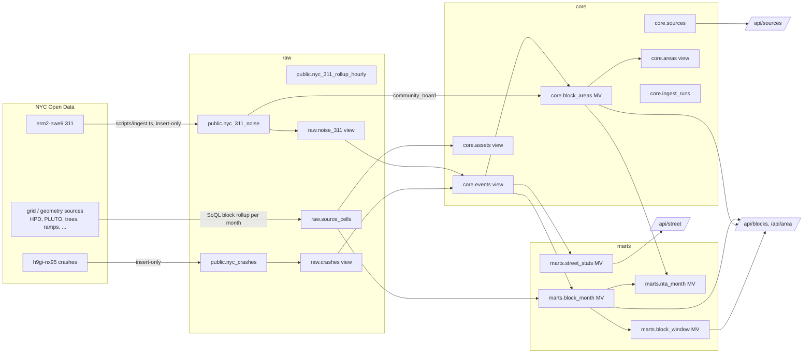

# Data model

The Octo workspace **nyc neighbourhood** holds everything in one Postgres 16 database, in three layers. Every object is created by a migration in `db/migrations/`; nothing is created by hand.

## Layers

| Layer | Object | Grain | Notes |
| --- | --- | --- | --- |
| raw | `public.nyc_311_noise`, `public.nyc_crashes`, `public.nyc_311_rollup_hourly`, `public.nyc_ingest_meta` | as loaded | Pre-existing tables, kept as-is. Ingestion only inserts. |
| raw | `raw.noise_311`, `raw.crashes`, `raw.rollup_311_hourly` | views | Names the existing tables inside the layered schema. |
| raw | `raw.source_cells` | source × month × block × category | Registry sources without an event table, rolled up by Socrata. `month IS NULL` is an inventory snapshot. |
| core | `core.sources` | one row per registry entry | Upserted from `src/lib/datasets/registry.ts` on every ingest: labels, polarity, guide, filters. |
| core | `core.events` | one row per event | Noise and crashes with block row/col (`floor(lat / 0.003)`, `floor(lon / 0.003)`), category, severity, street. |
| core | `core.assets` | source × block | Inventory sources (trees, ramps, PLUTO units, ...). |
| core | `core.block_areas` | block | Most common NTA 2020, borough and community district (`boro_cd`, from 311's `community_board`) per block. |
| core | `core.areas` | level × area | NTA / community district / borough lists. |
| core | `core.ingest_runs` | one row per source per run | Timings, row counts, errors. |
| marts | `marts.block_month` | source × month × block × category × severity | What `/api/blocks` sums for any window, unit and filter. |
| marts | `marts.nta_month` | source × month × NTA × category × severity | NTA rollup for reports. |
| marts | `marts.block_window` | source × window (90d, 12mo) × block | Totals plus citywide percentile; feeds `/api/area`. |
| marts | `marts.street_stats` | street × borough | Noise and crash counts and four-step levels (green, yellow, orange, red by citywide quartile) for the walk bubble. |

Windows are month-aligned: "90 days" sums the months that overlap the last 90 days, so it can include up to about four months. Crash data lags the calendar by weeks to months.

## Versioning

- Migrations are plain SQL in [dbmate](https://github.com/amacneil/dbmate) format (`-- migrate:up` / `-- migrate:down`), named `YYYYMMDDHHMMSS_name.sql`.
- There is no direct database connection (DSN), so `scripts/migrate.ts` applies them through Octo's SQL endpoint, each in one transaction, and records versions in `public.schema_migrations` exactly like dbmate. When a DSN exists, `dbmate up` works on the same files.
- `scripts/refresh-marts.ts` refreshes materialized views in dependency order.
- Later, once a DSN exists: move the core and marts SQL into dbt models and keep dbmate for raw DDL.

## Add a dataset

1. Find the Socrata id and check it has numeric lat/lon (a `grid` source) or a GeoJSON geometry (a `geometry` source).
2. Add an entry to `SOURCES` in `src/lib/datasets/registry.ts` with `guide` (what, caveats, cadence), `polarity`, and `dateField` if it is time-based. Add `filters` if it has categories or severity.
3. Run `pnpm exec tsx scripts/ingest.ts <id>` then `pnpm db:refresh`. The source shows up in `core.sources`, `marts.*`, `/api/sources`, the sources drawer and the filters with no other change.
4. If it needs event-level detail (categories, streets), add a migration that extends `core.events`, and a matching ingest function.
