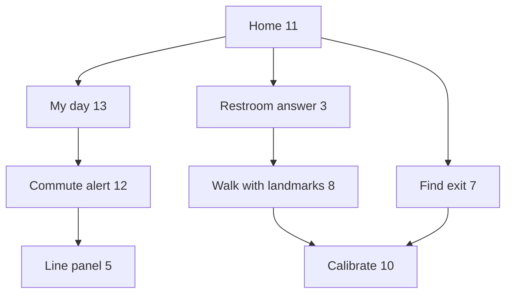

# Product design document: the agent-first app

*Handoff written 2026-10-24 for whichever coding agent (Codex CLI, Grok CLI, Claude or a person) finishes the work. Read `PROJECT.md` (what the app is for), `docs/DESIGN_RULES.md` (the owner's design rules, binding) and `AGENTS.md` (repository rules) first. This file says what to build next, how to check it and how to ship it.*

## The problem in one paragraph

The app is turning from a data dashboard into an accessible assistant: a clean, fast New York map with a chat and voice agent on top. The owner has agreed every screen on a design canvas. About two thirds of it is now built on one local branch, but the rest is not, nothing has been checked end to end in a browser, and nothing is deployed. The job is to finish the screens below, check them with Playwright at phone and desktop sizes against the design frames, and ship through one pull request to `main`, which deploys automatically.

## Where the work is

- **Branch:** `preview/agreed-ui`, a local branch (not pushed yet) checked out at the worktree `../nyc-map-agent-preview` next to the main checkout. It is `main` plus:
  - the 26 feature branches of the realignment, combined earlier as `integration/agent-first` (open PRs #346–#360 and #378–#393 each hold one piece);
  - the chat-first home and expandable commute alert (`feat/agreed-ui-chat`);
  - the round map buttons, Layers panel, Change view menu and subway line panel (`feat/agreed-ui-map`);
  - the design rules and the agent's standing rules (`docs/agent-design-rules`);
  - the first part of the work below (commits `08ba438`, `2277a0b`, `c5b8b71`).
- **Design frames:** `docs/design/frames/*.dc.html`, one file per screen, with `canvas.json` giving titles and layout. They are reference markup, not runnable pages: they need the design canvas runtime, and `{{name}}` holes are filled by the small script at the bottom of each file. Read the inline styles for exact sizes, colours and spacing. The owner can also show the live canvas.
- **Node modules:** `node_modules` in the preview worktree is a symlink to an installed copy. Run tools as `node_modules/.bin/<tool>` from the worktree, or run `pnpm install` for a real install.

## Screens and how they connect

| Frame file | Title | Status in code |
|---|---|---|
| `HomeDaily.dc.html` | 11 · Home for a daily explorer | Built (chat bar, Right now card, Home/Work pills, four task buttons); menu row added in `08ba438` |
| `Commute.dc.html` | 12 · Commute alert | Built: tappable notice and "Take the C instead" |
| `MyDay.dc.html`, `MyDayClosed.dc.html` | 13 · My day (open), 13b · closed | Menu row built; **dropdown contents to finish** |
| `Memory.dc.html` | 15 · Data (what we remember) | **To build** |
| `Main.dc.html` | 1 · Home, first visit | Built |
| `Listening2.dc.html` | 2 · Hands-free orb | Built |
| `Answer2.dc.html` | 3 · Answer card | Built |
| `Layers.dc.html` | 4 · Layers panel | Built; must move into the menu row |
| `Line.dc.html` | 5 · A subway line, selected | Built |
| `ViewMenu.dc.html` | 6 · Change view | Built; Aerial height changed in `c5b8b71` |
| `Trip.dc.html` | 6 · Plan trip preview | Exists from earlier work; restyle to match |
| `Exit.dc.html` | 7 · Find exit underground | Exists; restyle to match |
| `Walk.dc.html` | 8 · Walk with landmark checkpoints | Partly exists (landmark guide); restyle |
| `Train.dc.html` | 9 · Following your train | Built |
| `Calibrate.dc.html` | 10 · Aim the camera at a landmark | Not built (camera scaffold exists behind a flag) |
| `Bus.dc.html` | 14 · Following your bus | Partly; route drawn north–south, must be crosstown |

`Answer.dc.html` and `Listening.dc.html` are older options; ignore them.

The main flows, as the prototype links them:

Flow diagram

1. Home → My day → "Tonight" notice → commute alert → "Show me on the map" → line panel → "Follow a train" → following your train.
2. Home → Restroom → answer card → "Walk me there" → walk with landmarks; "I'm lost" → calibrate → back to the walk.
3. Home → Find exit → "I'm out" → calibrate → walk.
4. Home → Plan trip → preview → "Use this route" → following your train.
5. Home → menu row → Layers, Data, City data, Settings, Filters.

## Remaining work

Do these in order, one commit each, with tests where logic is involved. After each, run the checks in "Checking" and look at it in the browser.

1. **Menu row: verify and finish** (`src/features/agent/AgentHome.tsx` and neighbours, commit `08ba438`).
   - Order: My day, Layers, Filters, Data, City data, Settings.
   - The active item is always leftmost: a pill with icon and label, light when its dropdown is open, dark when closed. The rest follow as bare icons with no outline, sizes 44/40/34/28/24/20 px and opacity 1/0.8/0.5/0.28/0.14/0.06, wrapping round. The row fades out at its right edge.
   - No dots or arrows on the pill.
   - Tapping an icon makes it active and opens its dropdown. Tapping the active pill toggles it. Only one dropdown is open at a time.
   - *Done when:* at 390×800 it matches `MyDay.dc.html` and `MyDayClosed.dc.html`, and a Playwright test taps each item and checks it becomes leftmost.
2. **My day dropdown** (frame 13).
   - **Today:** the user's usual-line notices from what `commute.ts` and the alerts feed already give. Each row opens the commute notice or line panel.
   - **Your rides:** line-bullet chips of the usual trips.
   - **Looked up:** the last 5 trips the user planned, stored on the device only.
   - Sections fold; only one is open.
   - No food, café or shop suggestions, and no "leave later" advice.
3. **Data dropdown** (frame 15, "What we remember").
   - Switches with icon and short label: Daily rides, Home & Work, Chats · 30 days, Trips looked up, Exact location (off by default). Then See all, Data policy and a red Delete everything, with one confirmation.
   - Everything is stored in `localStorage` only. Turning a switch off stops recording that kind and clears it. No banner.
   - *Done when:* unit tests cover recording, switching off and delete-all.
4. **Layers, Filters, City data and Settings dropdowns.**
   - Layers moves the existing small panel (`Layers.dc.html`) into the row.
   - Filters reuses today's map filters.
   - City data opens the existing 311 and crash dashboards. This is the one place a focused full dashboard is allowed.
   - Settings collects the existing settings (language, voice, advanced mode).
5. **Right-side quick bar** (commit `2277a0b`, verify): Change view, a compass that appears only when the map is rotated or tilted, then Center on my location. Nothing else.
6. **Verify the fixes in `c5b8b71`.**
   - The "More layers" drawer never covers the chat bar on a phone.
   - With a line notice open, each station name shows once.
   - Aerial is clearly higher and wider than Closer.
7. **Short memory summary to the agent.**
   - When Daily rides or Home & Work is on, the client sends one line such as "Usually takes the A from 59 St to 14 St around 8:40 on weekdays". Add it as an optional field in `src/features/agent/schema.ts`; the server adds it to the system prompt (`server/features/agent/prompt.ts`) only when present.
   - Never send full history or coordinates.
   - Test both cases.
8. **Restyle the task screens to match their frames:** Trip (6), Exit (7), Walk (8), Train (9), Bus (14, crosstown route). Calibrate (10) can stay behind its flag if the camera work is too large; say so in the PR.
9. **Dead ends.** Every button in the frames does something or is hidden. What's nearby and Other options ask the agent.

## Checking

Run from the preview worktree. CI requires check, lint, api, e2e, deps, size and gitleaks to pass before `main` accepts a merge. The commands are in `package.json` and `.github/workflows/ci.yml`:

- type check (`tsc --noEmit`), eslint, vitest;
- dependency rules (`depcruise`): the core code must not import feature code;
- knip (unused code);
- size-limit: if a budget fails only because the new UI grew a bundle, raise that budget in `.size-limit.json` modestly and say by how much in the PR. The branch already needs the restrooms chunk at 2.7 kB, the agent overlay at 18.5 kB and all JS at 962 kB;
- the OpenAPI check (`tsx scripts/openapi.ts --check`);
- Playwright e2e.

**Seeing it in a browser:**

- **Dev server:** `API_PROXY_TARGET=https://nyc.design-bakery.com node_modules/.bin/vite --port 5195 --strictPort` runs the app against the production API, with no secrets needed.
- **Location:** in development it is faked to Elmhurst, Queens (`src/lib/geo/devGeo.ts`), so nothing asks for the real one. Never call `navigator.geolocation` directly; use `appGeo()`.
- **Playwright:** check at 390×800 and 1280×800. Take screenshots of each screen and compare them by eye (or with a vision model) against the frame files. Write e2e tests for the menu row, the Data switches and the chat bar staying visible.

## Shipping

1. Commit everything on `preview/agreed-ui`, push it, and open one pull request to `main`.
   - Write it reader-first, as `AGENTS.md` requires: the problem, what changes, how to verify, what stays the same.
   - List the PRs it folds in with `Refs #N`.
   - Mention that it supersedes draft #341, whose top-bar idea became the menu row.
2. Wait for the required checks.
3. Merging to `main` deploys to nyc.design-bakery.com: CI runs `pnpm db:migrate` on production, then the deploy.
   - This release carries one migration, `db/migrations/20261024000100_osm_toilets.sql`, which only adds a table and a view column.
   - Watch the deploy job to the end and open the site at phone size afterwards.
4. Afterwards, with the owner's OK, close the folded-in PRs with a comment pointing at the merged one.

## Rules that still apply

- Ask the owner before anything irreversible beyond this plan.
- Don't pull secrets from the production server.
- Updates go inside the app only, no push notifications.
- User data stays on the phone by default.
- Before filing any issue, follow the issue-log rules in `AGENTS.md`.
