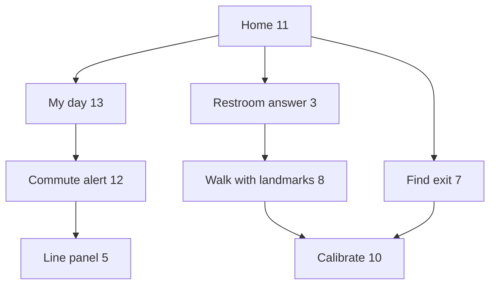
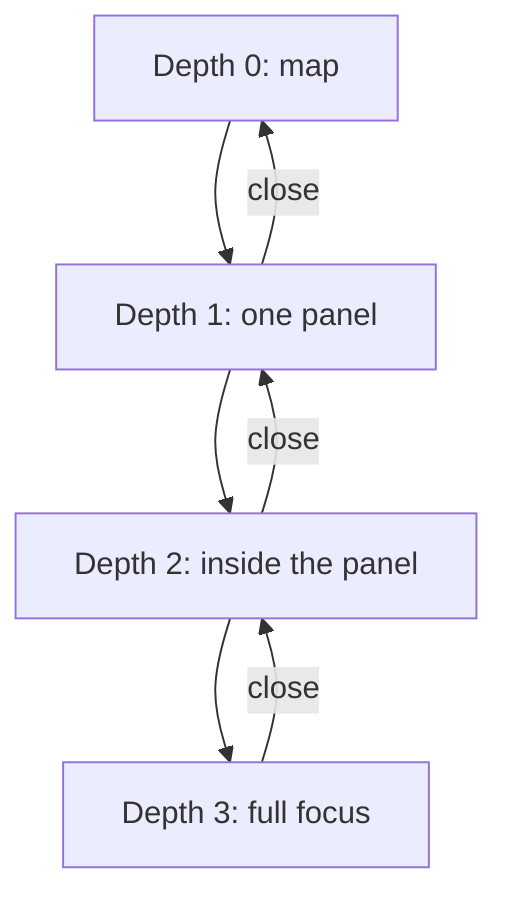

# Product design document: the agent-first app

*Handoff written 2026-10-24 for whichever coding agent (Codex CLI, Grok CLI, Claude or a person) finishes the work. Read `PROJECT.md` (what the app is for), `docs/DESIGN_RULES.md` (the owner's design rules, binding) and `AGENTS.md` (repository rules) first. This file says what to build next, how to check it and how to ship it.*

## The problem in one paragraph

The app is turning from a data dashboard into an accessible assistant: a clean, fast New York map with a chat and voice agent on top. The owner has agreed every screen on a design canvas. About two thirds of it is now built on one local branch, but the rest is not, nothing has been checked end to end in a browser, and nothing is deployed. The job is to finish the screens below, check them with Playwright at phone and desktop sizes against the design frames, and ship through one pull request to `main`, which deploys automatically.

## Where the work is

- **Branch:** `preview/agreed-ui`, a local branch (not pushed yet) checked out at the worktree `../nyc-map-agent-preview` next to the main checkout. It is `main` plus:
  - the 26 feature branches of the realignment, combined earlier as `integration/agent-first` (open PRs #346–#360 and #378–#393 each hold one piece);
  - the chat-first home and expandable commute alert (`feat/agreed-ui-chat`);
  - the round map buttons, Layers panel, Change view menu and subway line panel (`feat/agreed-ui-map`);
  - the design rules and the agent's standing rules (`docs/agent-design-rules`);
  - the first part of the work below (commits `08ba438`, `2277a0b`, `c5b8b71`).
- **Design frames:** `docs/design/frames/*.dc.html`, one file per screen, with `canvas.json` giving titles and layout. They are reference markup, not runnable pages: they need the design canvas runtime, and `{{name}}` holes are filled by the small script at the bottom of each file. Read the inline styles for exact sizes, colours and spacing. The owner can also show the live canvas.
- **Node modules:** `node_modules` in the preview worktree is a symlink to an installed copy. Run tools as `node_modules/.bin/<tool>` from the worktree, or run `pnpm install` for a real install.

## Screens and how they connect

| Frame file | Title | Status in code |
|---|---|---|
| `HomeDaily.dc.html` | 11 · Home for a daily explorer | Built (chat bar, Right now card, Home/Work pills, four task buttons); menu row added in `08ba438` |
| `Commute.dc.html` | 12 · Commute alert | Built: tappable notice and "Take the C instead" |
| `MyDay.dc.html`, `MyDayClosed.dc.html` | 13 · My day (open), 13b · closed | Menu row built; **dropdown contents to finish** |
| `Memory.dc.html` | 15 · Data (what we remember) | **To build** |
| `Main.dc.html` | 1 · Home, first visit | Built |
| `Listening2.dc.html` | 2 · Hands-free orb | Built |
| `Answer2.dc.html` | 3 · Answer card | Built |
| `Layers.dc.html` | 4 · Layers panel | Built; must move into the menu row |
| `Line.dc.html` | 5 · A subway line, selected | Built |
| `ViewMenu.dc.html` | 6 · Change view | Built; Aerial height changed in `c5b8b71` |
| `Trip.dc.html` | 6 · Plan trip preview | Exists from earlier work; restyle to match |
| `Exit.dc.html` | 7 · Find exit underground | Exists; restyle to match |
| `Walk.dc.html` | 8 · Walk with landmark checkpoints | Partly exists (landmark guide); restyle |
| `Train.dc.html` | 9 · Following your train | Built |
| `Calibrate.dc.html` | 10 · Aim the camera at a landmark | Not built (camera scaffold exists behind a flag) |
| `Bus.dc.html` | 14 · Following your bus | Partly; route drawn north–south, must be crosstown |

`Answer.dc.html` and `Listening.dc.html` are older options; ignore them.

The main flows, as the prototype links them:

Flow diagram

1. Home → My day → "Tonight" notice → commute alert → "Show me on the map" → line panel → "Follow a train" → following your train.
2. Home → Restroom → answer card → "Walk me there" → walk with landmarks; "I'm lost" → calibrate → back to the walk.
3. Home → Find exit → "I'm out" → calibrate → walk.
4. Home → Plan trip → preview → "Use this route" → following your train.
5. Home → menu row → Layers, Data, City data, Settings, Filters.

## Screen space: who wins and what closes what

Many things want the same small screen: the menu row's dropdowns, the line panel, the answer card, the voice orb, the trip preview, the follow card and the walk guide. These rules say which one wins. They apply to every screen size. **Status** says whether the code does it yet; anything marked *to build* doesn't exist until a commit names it.

### The focus always stays on screen

The **focus** is the one thing the person is tracking right now. The first item in this list that applies is the focus:

1. the train or bus they are following;
2. their own position on a walk or trip that is playing;
3. the place an answer is about (a restroom, an exit, a stretch of line);
4. the stretch of line a picked notice affects;
5. their own blue dot.

**Rule:** at depth 0, 1 and 2 (below), the focus is always inside the part of the map no panel covers. Only depth 3 may cover it.

**How the code does it** (built in #409 and #410, `src/lib/map/mapCover.ts`):
- Every panel that sits over the map is marked as a **cover**: `data-map-cover`, or the `task-top` / `task-bottom` classes.
- The map adds padding on the edge each cover sits against, so its centre (where the focus is kept) moves into the clear part.
- A cover wider than 60% of the map pads the top or bottom. A narrower one pads its side.
- At least a quarter of the map, and never less than 160 px, always stays clear in each direction. When two covers would take more than that, both paddings shrink by the same share.
- Fitting a route or an alert to the screen (`framePadding`) adds its own margins on top of the cover padding.

**When space runs out, the panel gives way, never the focus.** The steps, in order:
1. The panel's list scrolls inside a capped height. An opened notice is capped at 30% of the screen height and the answer at 44%.
2. The older of two panels folds down to its chip or pill.
3. Only then does a panel reach depth 3 and cover the focus.

### Depth levels

Each tap goes one level deeper. A casual user getting around should never need to go past depth 1.

| Depth | What it is | Examples | May cover the focus? |
|---|---|---|---|
| 0 | Map only, with the fixed parts | Chat bar, quick bar, menu row, task buttons | No |
| 1 | One surface opened by a tap: the least information that answers | A menu dropdown with its sections folded; Change view; the line panel (next trains and about one and a half notices); the answer card (one line and one button); the voice orb; the trip preview; the follow card; the walk guide; the exit card | No |
| 2 | One step inside it | An opened notice; **More** on an answer (sources, What's nearby, Other options); an unfolded section of My day; the agent's working steps | No |
| 3 | A deliberate full focus | City data dashboards; street view; a full notice or See all list; the Data policy page | Yes, and it closes back to depth 2 |

Depth diagram

Closing always steps back one level, so Esc and Back (`dismissTop`, built) close the top level first.

### Who wins

Only one depth-1 surface is open at a time, except for the pairs listed under each screen size. When a new one opens, the higher row in this table wins:

| Rank | Surface | When something higher opens | Status |
|---|---|---|---|
| 1 | An active task: following a train or bus, walking, the trip preview, find exit | Stays. It owns the screen until the person ends it. | Built |
| 2 | The voice orb (hands-free, listening) | Ends when a task starts (`AgentOverlay.tsx`); the spoken answer still finishes | Built |
| 3 | The answer card | Folds to its question chip when a task starts; reopens on tap | Fold *to build* |
| 4 | The line panel | Stays open beside an answer on tablet and desktop; on a phone it folds to its line pill while an answer is open | Fold *to build* |
| 5 | A menu dropdown or Change view | Closes. Opening one closes the other (`openMenu.ts`). The menu row is hidden while a line, a follow, a walk or street view is active (`MenuRow.tsx`). | Built |

What closes what, besides the ranking:
- **Sending a question** closes any drawer or details sheet (`closeAll`, built) and any open menu dropdown (*to build*).
- **Starting a task** (Use this route, Follow a train, Walk me there) closes the answer down to its chip (*to build*) and ends hands-free (built).
- **An empty-map tap** closes a details sheet and leaves the Layers drawer open (`panelSlot.ts`, built). It never closes an active task.
- **Opening a menu dropdown while an answer is open** folds the answer to its chip (*to build*). The dropdown is the single focus until it closes, and then the answer comes back.

### By screen size

| Size | Where panels dock | Pairs allowed together | Extra limits |
|---|---|---|---|
| **Small phone** (under 375 px wide or under 700 px tall, such as an iPhone SE) | Top or bottom, full width | None: the older surface folds to its chip | The clear strip is often the 160 px minimum. Depth-2 lists use the caps above. The task buttons hide while any depth-1 surface is open (*to verify*). |
| **Phone** (375–639 px) | Top (line panel, follow heading) or bottom (answer, orb, task card, chat bar) | One top and one bottom, if a quarter of the map stays clear | Same caps |
| **Tablet** (640–1023 px) | Sides. The answer, task cards and menu dropdowns go left; the line panel goes right from 768 px (built in #410). | A left and a right surface together | Between 640 and 767 px the line panel still spans the top. Make it dock right from 640 px to match the answer card (*to build*). |
| **Desktop** (1024 px and up) | Sides, the same as tablet. The line panel is 400 px wide. | A left and a right surface together | None |

### Checking these rules

*To build:* a Playwright test runs at 320×568, 375×667, 390×844, 820×1180, 1280×800 and 1440×900. For each depth-1 and depth-2 surface it:
1. opens the surface;
2. reads the map's padding and the cover rectangles;
3. checks that the focus point (the map centre after padding) is inside the clear area, and that the clear strip is at least 160 px;
4. checks that Esc steps back exactly one level.

## Remaining work

Do these in order, one commit each, with tests where logic is involved. After each, run the checks in "Checking" and look at it in the browser.

1. **Menu row: verify and finish** (`src/features/agent/AgentHome.tsx` and neighbours, commit `08ba438`).
   - Order: My day, Layers, Filters, Data, City data, Settings.
   - The active item is always leftmost: a pill with icon and label, light when its dropdown is open, dark when closed. The rest follow as icons on small dark discs with no outline, sizes 44/40/34/28/24/20 px and opacity 1/0.9/0.7/0.5/0.32/0.18, wrapping round. The row fades out at its right edge.
   - No dots or arrows on the pill.
   - Tapping an icon makes it active and opens its dropdown. Tapping the active pill toggles it. Only one dropdown is open at a time.
   - *Done when:* at 390×800 it matches `MyDay.dc.html` and `MyDayClosed.dc.html`, and a Playwright test taps each item and checks it becomes leftmost.
2. **My day dropdown** (frame 13).
   - **Today:** the user's usual-line notices from what `commute.ts` and the alerts feed already give. Each row opens the commute notice or line panel.
   - **Your rides:** line-bullet chips of the usual trips.
   - **Looked up:** the last 5 trips the user planned, stored on the device only.
   - Sections fold; only one is open.
   - No food, café or shop suggestions, and no "leave later" advice.
3. **Data dropdown** (frame 15, "What we remember").
   - Switches with icon and short label: Daily rides, Home & Work, Chats · 30 days, Trips looked up, Exact location (off by default). Then See all, Data policy and a red Delete everything, with one confirmation.
   - Everything is stored in `localStorage` only. Turning a switch off stops recording that kind and clears it. No banner.
   - *Done when:* unit tests cover recording, switching off and delete-all.
4. **Layers, Filters, City data and Settings dropdowns.**
   - Layers moves the existing small panel (`Layers.dc.html`) into the row.
   - Filters reuses today's map filters.
   - City data opens the existing 311 and crash dashboards. This is the one place a focused full dashboard is allowed.
   - Settings collects the existing settings (language, voice, advanced mode).
5. **Right-side quick bar** (commit `2277a0b`, verify): Change view, a compass that appears only when the map is rotated or tilted, then Center on my location. Nothing else.
6. **Verify the fixes in `c5b8b71`.**
   - The "More layers" drawer never covers the chat bar on a phone.
   - With a line notice open, each station name shows once.
   - Aerial is clearly higher and wider than Closer.
7. **Short memory summary to the agent.**
   - When Daily rides or Home & Work is on, the client sends one line such as "Usually takes the A from 59 St to 14 St around 8:40 on weekdays". Add it as an optional field in `src/features/agent/schema.ts`; the server adds it to the system prompt (`server/features/agent/prompt.ts`) only when present.
   - Never send full history or coordinates.
   - Test both cases.
8. **Restyle the task screens to match their frames:** Trip (6), Exit (7), Walk (8), Train (9), Bus (14, crosstown route). Calibrate (10) can stay behind its flag if the camera work is too large; say so in the PR.
9. **Dead ends.** Every button in the frames does something or is hidden. What's nearby and Other options ask the agent.
10. **Screen space rules: the parts marked *to build*** in "Screen space: who wins and what closes what" above.
    - Fold the answer to its question chip when a task starts or a menu dropdown opens.
    - Fold the line panel to its pill under an answer on a phone.
    - Close menu dropdowns when a question is sent.
    - Dock the line panel right from 640 px.
    - Add the Playwright check for the focus and the clear strip at the six sizes.
    - *Done when:* that check passes at every size.

## Checking

Run from the preview worktree. CI requires check, lint, api, e2e, deps, size and gitleaks to pass before `main` accepts a merge. The commands are in `package.json` and `.github/workflows/ci.yml`:

- type check (`tsc --noEmit`), eslint, vitest;
- dependency rules (`depcruise`): the core code must not import feature code;
- knip (unused code);
- size-limit: if a budget fails only because the new UI grew a bundle, raise that budget in `.size-limit.json` modestly and say by how much in the PR. The branch already needs the restrooms chunk at 2.7 kB, the agent overlay at 18.5 kB and all JS at 962 kB;
- the OpenAPI check (`tsx scripts/openapi.ts --check`);
- Playwright e2e.

**Seeing it in a browser:**

- **Dev server:** `API_PROXY_TARGET=https://nyc.design-bakery.com node_modules/.bin/vite --port 5195 --strictPort` runs the app against the production API, with no secrets needed.
- **Location:** in development it is faked to Elmhurst, Queens (`src/lib/geo/devGeo.ts`), so nothing asks for the real one. Never call `navigator.geolocation` directly; use `appGeo()`.
- **Playwright:** check at 390×800 and 1280×800. Take screenshots of each screen and compare them by eye (or with a vision model) against the frame files. Write e2e tests for the menu row, the Data switches and the chat bar staying visible.

## Shipping

1. Commit everything on `preview/agreed-ui`, push it, and open one pull request to `main`.
   - Write it reader-first, as `AGENTS.md` requires: the problem, what changes, how to verify, what stays the same.
   - List the PRs it folds in with `Refs #N`.
   - Mention that it supersedes draft #341, whose top-bar idea became the menu row.
2. Wait for the required checks.
3. Merging to `main` deploys to nyc.design-bakery.com: CI runs `pnpm db:migrate` on production, then the deploy.
   - This release carries one migration, `db/migrations/20261024000100_osm_toilets.sql`, which only adds a table and a view column.
   - Watch the deploy job to the end and open the site at phone size afterwards.
4. Afterwards, with the owner's OK, close the folded-in PRs with a comment pointing at the merged one.

## Rules that still apply

- Ask the owner before anything irreversible beyond this plan.
- Don't pull secrets from the production server.
- Updates go inside the app only, no push notifications.
- User data stays on the phone by default.
- Before filing any issue, follow the issue-log rules in `AGENTS.md`.
