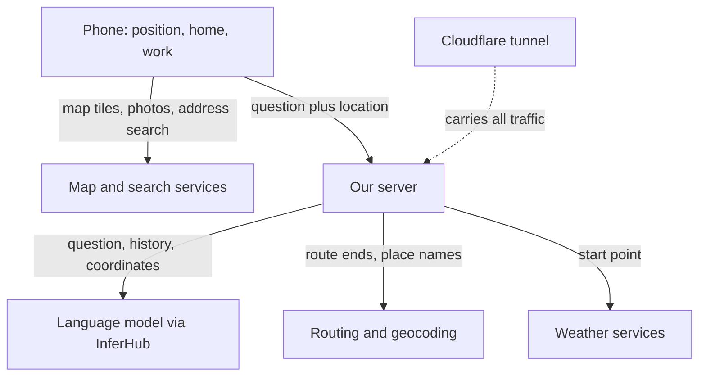

# Location data policy

> **DRAFT for the owner to approve.** Nothing here is a promise to users yet. It describes what the code does today (main at `24ed8dd`, plus open pull request #327 for saved home and work), proposes the rule we should state, and lists the gaps where the code does not yet meet that rule. Tracked in issue #374, part of #361.

## The rule in one paragraph (proposal)

Your exact position stays on your phone unless you tap **Use my location** or ask the assistant a question that needs it. When it leaves the phone, it goes to our server for that one answer and is not written down there. Our server passes only what each outside service needs to answer: a routing service gets the two ends of the route, a weather service gets a rough area, and the language model gets words like "here" and "home" rather than numbers. Saved home and work stay on your phone until you clear them.

## How location moves through the app

The same flow as a list, in case the diagram does not render:

1. The phone keeps your shared position in memory and, with #327, saves home and work in the browser's storage.
2. The phone talks directly to map tile, street photo, address search and walking route services.
3. When you ask the assistant, the phone sends the question, the conversation so far, your shared position (if sharing is on) and your saved home and work (if any) to our server.
4. Our server sends the question, the conversation and, today, your exact coordinates to the language model through InferHub, a paid marketplace that forwards requests to model providers.
5. Our server looks up routes, addresses and weather with outside services, sending them coordinates.
6. All traffic between the phone and our server passes through Cloudflare, which runs the tunnel to our machine.

## What stays on your phone

| Data | Where it is kept | How long | How to clear it |
|---|---|---|---|
| Your live position after **Use my location** | Page memory only, never browser storage, cookies or the web address (`src/lib/geo/sharedLocation.ts:3-9`) | Until you tap **Stop sharing location** or close the tab | **Stop sharing location** (`src/lib/geo/sharedLocation.ts:59-63`) |
| Your position during 2D turn-by-turn navigation | Page memory only (`src/features/liveview/RouteGuide.tsx:113-141`) | Until navigation stops or the route is cleared | Stop navigation |
| Route start and end you picked on the map | Page memory only (`src/lib/store/DataViewContext.tsx:161`) | Until you clear the route or close the tab | Clear the route |
| Assistant conversation | Page memory only (`src/features/agent/AgentOverlay.tsx:57`) | Until the tab closes | Close the tab (no clear button yet) |
| Saved home and work (#327, not merged) | Browser storage under the key `nma.homeWork`, as a label and exact coordinates (`src/lib/map/savedPlaces.ts:10`, `:27` on branch `fix/home-work`) | Forever, until cleared | **Clear home** and **Clear work**, one at a time, in Layers and filters (`src/components/LayersDrawer.tsx:208` on that branch) |
| Starred stations, map settings, theme | Browser storage (`src/features/transit/hooks.ts:219-239`, `src/lib/map/mapOptions.ts:49`) | Until cleared | Browser settings. These are not positions. |

The web address never carries your position. The `at=` parameter is read when someone opens a shared street link (`src/components/MapView.tsx:308`), but the app never writes your position into it. Filters and transit choices in the address are not locations.

## What reaches our server

| Request | What it carries | Kept? |
|---|---|---|
| Ask the assistant (`POST /api/agent`) | The conversation (up to 30 messages), your exact shared position if sharing is on (`src/features/agent/schema.ts:154`, sent at `src/features/agent/AgentOverlay.tsx:112-128`), your street view spot and heading if you asked from street view (`src/features/agent/schema.ts:137-145`), and with #327 your saved home and work on every question (`src/features/agent/AgentOverlay.tsx:137-139` on `fix/home-work`) | Not stored. Used for this answer only (`server/features/agent/routes.ts:19-23`). |
| Weather for the map (`GET /api/weather`) | The map centre rounded to about 100 metres (`src/features/weather/weatherLayers.ts:37`) | Held in a memory cache for about 10 minutes, keyed by an area about 5 kilometres wide (`server/features/weather/routes.ts:66-70`) |
| Parking rules near a place (`GET /api/parking/rules`) | The picked place to about 1 metre (`src/features/parking/StreetRules.tsx:12`) | Held in a memory cache for an hour, keyed by an area about 100 metres wide (`server/features/parking/routes.ts:166-167`) |

**Server logs.** Neither our server nor Caddy (the web server in front of it) writes a line per request:

- The app adds no request logger (`server/app.ts`, `server/node.ts`).
- The Caddy configuration has no `log` directive, and Caddy writes no access log without one (`deploy/Caddyfile`).
- The server prints only its start-up line, model failures (status and up to 160 characters of the provider's error text, `server/features/agent/routes.ts:81-86`, `server/features/agent/model-fallback.ts:67`, `:76`) and transit feed errors (`server/features/transit/routes.ts:285`).
- Container logs are capped at three 10 megabyte files (`deploy/docker-compose.yml:34-36`).

Not checked: whether Cloudflare keeps request logs for our account, and whether our own OpenTripPlanner container logs trip searches (see gaps).

## What reaches the language model

The model runs outside our machine. Our server calls InferHub with the `@ai-sdk/openai-compatible` library (`server/features/agent/routes.ts:52-57`). InferHub forwards each request to one of several model providers. Every question sends:

- **The whole conversation so far**, including any addresses you typed (`server/features/agent/routes.ts:76`).
- **Your exact shared position as numbers**, written into the instructions (`server/features/agent/routes.ts:40-41`). The model is told not to repeat them, but it still receives them.
- **Your street view spot and heading** when you ask from street view (`server/features/agent/routes.ts:24-31`).
- **Tool results that contain coordinates.** The assistant's `geocode` tool hands the model the exact coordinates of whatever it looked up, including "here" (`server/features/agent/tools.ts:46-49`, `:63`). With #327 the same is true of "home" and "work" (`server/features/agent/tools.ts:62`, `:78` on `fix/home-work`). The instructions for #327 send only the home and work labels (`server/features/agent/routes.ts:39` on that branch), so this tool is the leak.

How long InferHub or the provider behind it keeps a request is not known; we have not read their terms.

## What reaches each outside service

| Service | Who runs it | What it receives | Sent from |
|---|---|---|---|
| Map tiles (OpenFreeMap, OpenStreetMap tiles) | OpenFreeMap; OpenStreetMap Foundation | Which tiles you view, which shows the area you are looking at, plus your internet address | Phone (`src/lib/map/basemap.ts:13`, `src/lib/map/style.ts:22`) |
| Address search (GeoSearch) | NYC Department of City Planning | Text you type into search; your internet address | Phone (`src/lib/api/geosearch.ts:23`) |
| Address search for the assistant | Same | Place names the assistant looks up, and exact points to name a street (`server/features/agent/services.ts:29`, `:49`, used at `server/features/agent/trip.ts:36`) | Our server |
| Walking routes (OSRM, the Open Source Routing Machine) | FOSSGIS, a German volunteer association | Both route ends to about 10 centimetres; from the phone, also your internet address | Phone (`src/lib/api/routing.ts:46-56`) and our server (`server/features/agent/services.ts:73-74`) |
| Driving routes (OSRM car) | FOSSGIS | Both route ends | Our server (`server/features/agent/drive/router.ts:51`) |
| Transit trip search (OpenTripPlanner) | Us, in our own container | Both trip ends | Our server (`server/features/agent/otp.ts:74`). Stays on our machine. |
| Weather forecast (Open-Meteo) | Open-Meteo | The assistant's trip start exactly (`server/features/agent/services.ts:89`, called from `server/features/agent/plan.ts:19`); the map's weather an area about 5 kilometres wide (`server/features/weather/routes.ts:44`) | Our server |
| Weather alerts (NWS, the National Weather Service) | United States government | The trip start to about 10 metres (`server/features/agent/services.ts:99`) | Our server |
| NYC Open Data | City of New York | A box around a driving route (`server/features/agent/drive/context.ts:59`); a circle around a picked parking place (`server/features/parking/routes.ts:183`) | Our server |
| Street photos (Mapillary) | Meta | A box around the block you opened, plus your internet address (`src/lib/api/mapillary.ts:98-115`, `src/components/StreetViewSheet.tsx:101-103`) | Phone. Uses the picked block, not your position. |
| MTA (the Metropolitan Transportation Authority) feeds | MTA | No location. We download whole feeds. (`server/features/agent/services.ts:109`, `:130`) | Our server |
| Speech recognition for "Hey map" | Your browser's maker | Your voice, if you turn it on (`src/features/agent/useWakePhrase.ts:26-27`) | Phone |
| Cloudflare tunnel | Cloudflare | Every request to our server, including the assistant questions and coordinates above | In transit |

Calls our server makes do not reveal your internet address to the outside service. Calls the phone makes do.

## Gaps found, with recommended fixes (proposal)

1. **Exact coordinates go to the model.** The instructions carry your shared position as numbers, and the `geocode` tool returns exact coordinates for "here", "home" and "work". *Fix:* keep coordinates on our server in the tool context, tell the model only "location shared", and return labels and distances from tools instead of `at` numbers for "here", "home" and "work".
2. **The on-screen promise is wrong.** The assistant says your location is sent "only for that question" (`src/features/agent/AgentOverlay.tsx:229`), but once sharing is on it is sent with every question until you stop sharing (`:112`). *Fix:* change the text to "sent with each question until you tap Stop sharing location", or clear sharing after each answer.
3. **Saved places go with every question** (#327), even ones that have nothing to do with home or work. *Fix:* send home or work only when the question names them, or resolve them on the phone.
4. **No one-step clear.** Home and work are cleared one at a time, and the conversation has no clear button. *Fix:* add **Forget my places and conversation**, which removes `nma.homeWork`, stops sharing and empties the conversation.
5. **Model provider retention is unknown.** *Fix:* read InferHub's terms, record how long it and its providers keep requests, and pick a no-retention option if one exists.
6. **Cloudflare and OpenTripPlanner logging not checked.** *Fix:* check the Cloudflare account's log settings and the OpenTripPlanner container's log level, then record the answer here.
7. **More precision than needed.** Weather alerts and forecasts for a trip get the exact start; the phone sends parking lookups to about 1 metre. *Fix:* round to about 1 kilometre for weather and alerts, about 10 metres for parking.
8. **The policy is not shown in the app.** Issue #374 asks for it. *Fix:* link this page from the assistant panel and the Layers and filters home and work section once approved.

## Caveat

This audit read the code; it did not watch network traffic. Pull request #327 may change before it merges, and review fixes not yet pushed to `fix/home-work` were not read.
